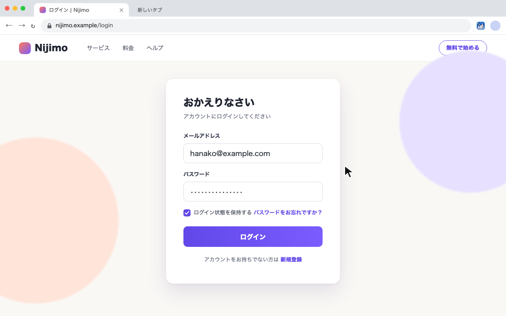
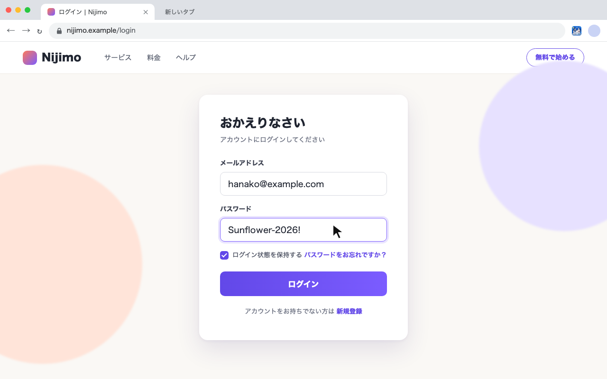

  

<h1 align="center">Show Password on Hover</h1>

パスワード欄にマウスを乗せると入力内容が表示され、マウスを離すと伏せ字に戻る Chrome 拡張機能です。

A Chrome extension that shows a password field's contents while you hover over it and hides them again when the mouse leaves.

## 使い方 / How it works

**1. 通常は伏せ字のまま / Hidden as usual**

**2. パスワード欄にマウスを乗せると表示 / Hover to reveal**

マウスを離すと、自動で伏せ字に戻ります。/ Move the mouse away and it hides again automatically.

## 特長 / Features

- 設定不要で、すべてのサイトで動作します / No setup; works on every site
- 追加の権限なし、外部への通信なし、データの保存なし / No extra permissions, no network requests, no data stored
- コードは約 20 行の [`content.js`](content.js) だけです / The whole extension is about 20 lines in [`content.js`](content.js)

## インストール / Install

手動で入れる場合 / Manual install:

1. このリポジトリをダウンロードします / Download this repository
2. `chrome://extensions` を開き、「デベロッパーモード」をオンにします / Open `chrome://extensions` and turn on Developer mode
3. 「パッケージ化されていない拡張機能を読み込む」から、このフォルダを選びます / Click "Load unpacked" and choose this folder

## プライバシー / Privacy

[PRIVACY.md](PRIVACY.md) を参照してください / See [PRIVACY.md](PRIVACY.md).

## ライセンス / License

[MIT](LICENSE)
